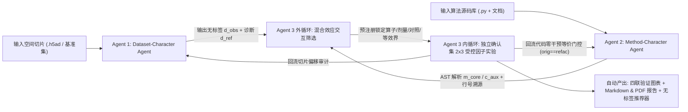

# 给导师汇报的项目简报：多智能体驱动的空间组学受控因子元基准框架（FACTOR Demo）

## 1. 一句话定位：我们要解决什么真问题？
现有空间转录组学（如空间域 / 微环境识别）Benchmark 多停留在**“报总体排名”**或**“手工预设几个模拟参数跑静态网格”**。当研究者看到“算法 A 在脑皮层切片很好、在肿瘤浸润或薄层组织拉胯”时，很难区分这究竟源于**数据空间特征与模型图平滑偏置的交互冲突**，还是仅仅源于**默认预处理（PCA vs. HVG）与超参失配**。

我们构建了一套**三智能体协同 + 确定性统计内核**的主动因子实验框架（**FACTOR**），把评测从“事后看排行榜猜原因”推进到**“自动提假设 $\rightarrow$ 双侧受控干预实验验证 $\rightarrow$ 独立样本复验与无标签选型推荐”**。

---

## 2. 三组智能体怎么分工？（智能体做解析编排，确定性代码做计算裁决）

1. **`Dataset-Character Agent`（数据集特征提取与偏移诊断）**
   - 调用空间统计工具计算切片的密度、稀疏度、全局 Moran's $I$、局部邻域表达异质性等，并严格将**测试时可用的无标签特征 `d_obs`** 与**回顾诊断用的真值依赖特征 `d_ref`** 物理隔离；
   - 在内循环对扰动后的切片做**干预有效性与非目标偏移审计**（监控非目标特征漂移与基因间相关矩阵 Frobenius 漂移）。
2. **`Method-Character Agent`（AST 源码解析与等价门控）**
   - 调用 Python `ast` 静态语法树分析器扫描方法源码，提取核心空间建模机制 `m_core`（多跳无剪枝平滑、表达注意力边门控、邻域特征拼接、DGI 对比损失等）与辅助管线 `c_aux`（默认 `PCA/HVG`、`GMM/KMeans`），**每项属性直接绑定源码文件名与起止行号**；
   - 负责运行**代码重构等价对照（`orig == refac`）**，确保模块化挂钩本身零误差。
3. **`D–M Interaction & Counterfactual Agent`（双循环假设筛选与受控因子验证）**
   - **外循环（仅在探索集 `D_expl` 上）**：拟合带高斯随机效应收缩且包含 `D×M` 与 `D×C` 竞争交互项的惩罚混合模型（配供体聚类 Bootstrap 稳定度），生成候选实验优先级并**预注册锁定实验规格**；
   - **内循环（在独立保留供体确认集 `D_conf` 上）**：执行参数化数据扰动（如 `u2` 边界细胞置换、`u1` Spot 空间聚合）$\times$ 四臂方法对照（`orig` 原实现、`refac` 重构真图、`self` 单位阵无跨细胞聚合、`null` 同谱节点置换随机图），同步对比默认配置（`fixed`）与等预算重调优（`retuned`），并做 `PCA vs. HVG` 直接交叉实验。

---

## 3. Demo 已经落地的核心验证内容（可直接现场演示）

| 演示模块 | 具体内容 | 对应图表/产物 |
| :--- | :--- | :--- |
| **源码级方法理解** | 自动解析 `GCN_DGI`、`GAT_AE`、`BANKSY_Concat`、`Expr_Smooth_Baseline` 四个代表性模块源码并输出行号证据链 | `MethodProfile` 表 & Notebook Step 2 |
| **观测性能反转与筛选** | 展示层状切片 vs. 薄层/浸润切片上的性能交叉，以及 `D×M` 与 `D×C` 竞争筛选排序 | `fig1_observational_screening.png` |
| **3 剂量 × 3 对照臂曲线** | 在独立确认集上展示随边界浸润率升高（$0\% \to 25\% \to 50\%$），真实空间图相对自环图与同谱随机图的净优势如何分化 | `fig2_factorial_2x3_curves.png` |
| **单切片可视化案例** | 直观对比薄层切片在 $0\%$ 与 $50\%$ 边界浸润下，无剪枝图平滑吞没薄层 vs. 邻域拼接保留结构的空间分布图 | `fig3_tissue_map_case_study.png` |
| **等效区间与竞争归因** | 展示带 $\pm 0.03$ 等效带的交互效应森林图（`fixed` vs. `retuned`）、`PCA vs. HVG` 交叉对比，以及无标签 `d_obs` 推荐器的遗憾值下降 | `fig4_forest_and_competing_checks.png` + `experiment_report.pdf` |

---

## 4. 下一步工作计划（导师确认方向后）
1. **接入大规模真实图谱**：直接通过已内置的 `load_h5ad_slice` 接口接入 10x Visium DLPFC（12 切片）、小鼠脑 MERFISH（多供体）与人类肿瘤 Xenium 切片；
2. **扩充方法适配器库**：对接 Descoeudres et al. (2026) 已开源的 Snakemake 模块化空间域方法库（扩至 10–15 个主流 PyTorch/R 工具）；
3. **系统级效率评测**：在相同 GPU 预算下定量对比主动实验选择相对固定网格与随机实验的有效复验发现产出率。
