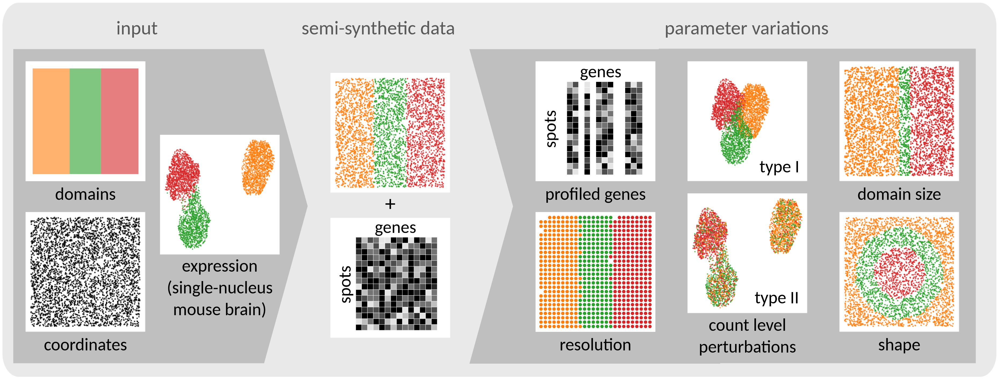

# Spatial Domain Simulator

This repository contains code to enable the generation of domain-aware semi-synthetic spatial transcriptomics data.

Please see the tutorial, available as a [jupyter notebook](https://github.com/canzarlab/spatial-domain-simulator/blob/main/tutorial.ipynb) or [in html](https://github.com/canzarlab/spatial-domain-simulator/blob/main/tutorial.html), for an introduction on how to use our simulation approach. 

This is the sister repository to our [spatial domain analysis framework](https://github.com/canzarlab/spatial-domain-analysis-framework).

## Citation
The simulation approach is described in the following preprint: 
Descoeudres, A., Prusina, T., Schmidt, N., Do, V. H., Mages, S., Klughammer, J., Matijevic, D., & Canzar, S. (2026). An explanatory benchmark of spatial domain detection reveals key drivers of method performance. bioRxiv. doi.org/10.64898/2026.03.12.710462
