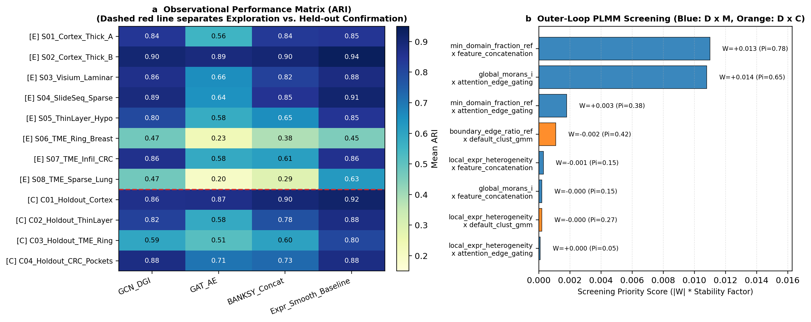
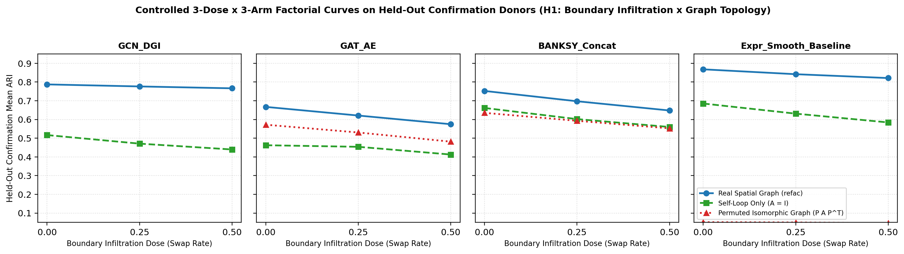
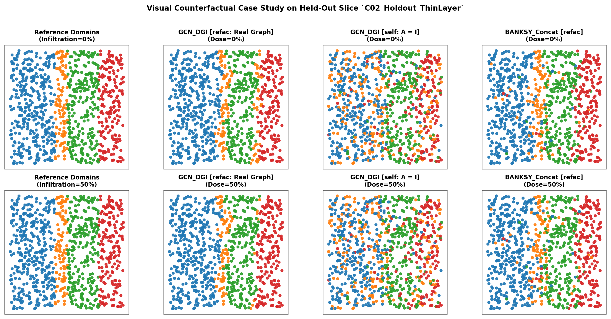
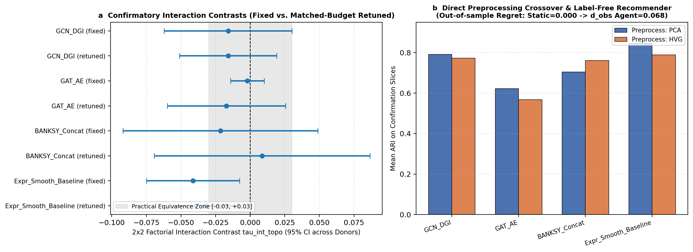

# FACTOR Demo 实验验证报告：多智能体驱动的空间组学双侧受控因子基准

- **生成时间**：`2026-11-27 22:58:36`
- **智能体推理模式**：`Offline Deterministic Tool-Grounded Trace Mode`
- **锁定的目标任务**：多细胞空间域识别（Multicellular Spatial Domain Segmentation）
- **样本划分**：探索集 `8 张切片（4 个供体）` vs. 独立确认集 `4 张保留供体切片`（探索筛选与统计确认严格隔离）

---

## 一、 三组智能体协同职责与执行摘要

1. **Dataset-Character Agent（数据集表征与偏移诊断）**：调用确定性空间统计工具提取无标签可观测特征 `d_obs`（用于样本外推荐）与参考依赖诊断特征 `d_ref`（仅用于回顾归因），并在内循环对扰动切片执行干预有效性与非目标偏移审计。
2. **Method-Character Agent（AST 源码静态解析与等价门控）**：直接解析各空间域方法源码抽象语法树（AST），提取空间归纳偏置 `m_core` 与耦合辅助管线 `c_aux`，每个特征绑定精确源码行号 `CodeSpan`，并验证代码钩子在零干预下与原实现严格等价（`orig == refac`）。
3. **D–M Interaction & Counterfactual Agent（外循环筛选 + 内循环受控 2×3 因子实验）**：在探索集上运行包含 `D×M` 与 `D×C` 竞争项的惩罚线性混合模型（PLMM + 供体聚类 Bootstrap），预先锁定参数化干预算子与等效区间（TOST），在独立确认集上分离检验 `refac`（真实空间图）、`self`（单位阵无跨单元聚合）与 `null`（同谱节点置换图）在默认配置与等预算重调优下的交互效应。

### Agent 3 综合科学裁决摘要

1. **Operator-Specific Bilateral Interaction (`u2_boundary_infiltration x Graph Topology`)**: Across independent confirmation donors, increasing cross-boundary cellular infiltration from 0% to 50% alters topological advantage (`refac - null`):
   - `GCN_DGI`: simple topological effect shifts from +0.757 (0% swap) to +0.742 (50% swap), donor-clustered interaction tau_int_topo = -0.016 (95% CI [-0.062, +0.030], status: **Inconclusive**).
   - `GAT_AE`: simple topological effect shifts from +0.095 (0% swap) to +0.093 (50% swap), donor-clustered interaction tau_int_topo = -0.002 (95% CI [-0.014, +0.010], status: **Practically Equivalent (TOST alpha=0.05)**).
   - `BANKSY_Concat`: simple topological effect shifts from +0.117 (0% swap) to +0.096 (50% swap), donor-clustered interaction tau_int_topo = -0.021 (95% CI [-0.092, +0.049], status: **Inconclusive**).
   - `Expr_Smooth_Baseline`: simple topological effect shifts from +0.817 (0% swap) to +0.775 (50% swap), donor-clustered interaction tau_int_topo = -0.041 (95% CI [-0.075, -0.008], status: **Statistically Non-Zero (Within/Overlapping Margin)**).
2. **Crossed `Dose x Preprocessing Scheme (PCA-20 vs. HVG-110)` Test**: `GCN_DGI` (mean PCA-HVG=+0.019, dose interaction tau_prep=+0.018), `GAT_AE` (mean PCA-HVG=+0.054, dose interaction tau_prep=-0.004), `BANKSY_Concat` (mean PCA-HVG=-0.057, dose interaction tau_prep=-0.003), `Expr_Smooth_Baseline` (mean PCA-HVG=+0.057, dose interaction tau_prep=-0.005) — directly quantifying how much regime shift comes from preprocessing scheme vs. graph topology.
3. **Out-of-Sample & Active Queue Metrics**: Label-free `d_obs` recommender regret = 0.0676 (vs. static winner 0.0001); pre-registered active priority queue hit 0/4 non-zero interactions (vs. random expectation 0.50).

---

## 二、 Agent 1 输出：空间切片元特征矩阵（`d_obs` 与 `d_ref` 分离）

| 切片 ID | 划分 | 平台 | 组织类型 | 密度 (`d_obs`) | 稀疏度 (`d_obs`) | Moran's I (`d_obs`) | 局部表达异质性 (`d_obs`) | 最小域占比 (`d_ref`) | 边界跨边率 (`d_ref`) |
| :--- | :--- | :--- | :--- | :---: | :---: | :---: | :---: | :---: | :---: |
| `S01_Cortex_Thick_A` | `exploration` | MERFISH_sc | Brain_Cortex | 0.252 | 52.42% | 0.115 | 0.465 | 0.214 | 0.075 |
| `S02_Cortex_Thick_B` | `exploration` | MERFISH_sc | Brain_Cortex | 0.257 | 56.63% | 0.338 | 0.497 | 0.239 | 0.069 |
| `S03_Visium_Laminar` | `exploration` | Visium_spot | DLPFC_Like | 0.237 | 71.34% | 0.066 | 0.692 | 0.243 | 0.078 |
| `S04_SlideSeq_Sparse` | `exploration` | SlideSeq_10um | Cerebellum | 0.250 | 86.36% | 0.049 | 0.852 | 0.241 | 0.076 |
| `S05_ThinLayer_Hypo` | `exploration` | Xenium_sc | Hypothalamus | 0.263 | 51.03% | 0.299 | 0.475 | 0.093 | 0.081 |
| `S06_TME_Ring_Breast` | `exploration` | Xenium_sc | Breast_TME | 0.264 | 52.97% | 0.145 | 0.551 | 0.092 | 0.132 |
| `S07_TME_Infil_CRC` | `exploration` | CosMx_sc | CRC_Invasive | 0.259 | 59.03% | 0.150 | 0.534 | 0.182 | 0.049 |
| `S08_TME_Sparse_Lung` | `exploration` | SlideSeq_10um | Lung_TME | 0.253 | 82.24% | 0.020 | 0.830 | 0.067 | 0.124 |
| `C01_Holdout_Cortex` | `confirmation` | MERFISH_sc | Brain_Cortex | 0.261 | 52.15% | 0.247 | 0.473 | 0.216 | 0.077 |
| `C02_Holdout_ThinLayer` | `confirmation` | Xenium_sc | Hypothalamus | 0.266 | 52.90% | 0.164 | 0.477 | 0.110 | 0.069 |
| `C03_Holdout_TME_Ring` | `confirmation` | Xenium_sc | Breast_TME | 0.261 | 54.15% | 0.156 | 0.506 | 0.075 | 0.133 |
| `C04_Holdout_CRC_Pockets` | `confirmation` | CosMx_sc | CRC_Invasive | 0.261 | 56.99% | 0.247 | 0.495 | 0.192 | 0.057 |
| `T01_External_Cortex` | `external_test` | STARmap_sc | Visual_Cortex | 0.258 | 53.02% | 0.197 | 0.507 | 0.218 | 0.065 |
| `T02_External_ThinSandwich` | `external_test` | Xenium_sc | Retina_Layers | 0.258 | 52.03% | 0.181 | 0.482 | 0.125 | 0.080 |
| `T03_External_TME_Invasive` | `external_test` | CosMx_sc | Melanoma_TME | 0.263 | 53.41% | 0.097 | 0.560 | 0.077 | 0.127 |

---

## 三、 Agent 2 输出：方法归纳偏置向量与 AST 代码行号溯源

| 方法 ID | 方法家族 | 空间图 | 多跳无剪枝平滑 | 注意力边门控 | 邻域特征拼接 | 默认预处理 (`c_aux`) | 默认聚类头 (`c_aux`) | AST 源码行号证据（自动提取） |
| :--- | :--- | :---: | :---: | :---: | :---: | :---: | :---: | :--- |
| `GCN_DGI` | GNN_Contrastive | 1 | 1 | 0 | 0 | `HVG` | `GMM` | `gcn_dgi_domain.py:L116-176` (runner_entrypoint); `gcn_dgi_domain.py:L128-128` (default_prep); `gcn_dgi_domain.py:L129-129` (default_clust) |
| `GAT_AE` | GNN_Autoencoder | 1 | 0 | 1 | 0 | `PCA` | `GMM` | `gat_ae_domain.py:L96-153` (runner_entrypoint); `gat_ae_domain.py:L108-108` (default_prep); `gat_ae_domain.py:L109-109` (default_clust) |
| `BANKSY_Concat` | Feature_Concatenation | 1 | 0 | 0 | 1 | `PCA` | `KMeans` | `banksy_aug_domain.py:L35-96` (runner_entrypoint); `banksy_aug_domain.py:L47-47` (default_prep); `banksy_aug_domain.py:L48-48` (default_clust) |
| `Expr_Smooth_Baseline` | Posthoc_Baseline | 1 | 0 | 0 | 0 | `PCA` | `KMeans` | `expr_baseline.py:L39-73` (runner_entrypoint); `expr_baseline.py:L51-51` (default_prep); `expr_baseline.py:L52-52` (default_clust) |

---

## 四、 外循环观测性能矩阵与混合效应筛选优先级

| 排名 | 数据特征 | 方法/管线特征 | 交互组别 | 混合模型估计值 `W` | 供体 Bootstrap 稳定度 `Pi` | 优先分 |
| :---: | :--- | :--- | :---: | :---: | :---: | :---: |
| 1 | `min_domain_fraction_ref` | `feature_concatenation` | `D_x_M` | +0.0128 | 0.78 | 0.0110 |
| 2 | `global_morans_i` | `attention_edge_gating` | `D_x_M` | +0.0140 | 0.65 | 0.0108 |
| 3 | `min_domain_fraction_ref` | `attention_edge_gating` | `D_x_M` | +0.0030 | 0.38 | 0.0018 |
| 4 | `boundary_edge_ratio_ref` | `default_clust_gmm` | `D_x_C` | -0.0018 | 0.42 | 0.0011 |
| 5 | `local_expr_heterogeneity` | `feature_concatenation` | `D_x_M` | -0.0006 | 0.15 | 0.0003 |
| 6 | `global_morans_i` | `feature_concatenation` | `D_x_M` | -0.0004 | 0.15 | 0.0002 |
| 7 | `local_expr_heterogeneity` | `default_clust_gmm` | `D_x_C` | -0.0004 | 0.27 | 0.0002 |
| 8 | `local_expr_heterogeneity` | `attention_edge_gating` | `D_x_M` | +0.0004 | 0.05 | 0.0001 |

---

## 五、 预注册假设与干预有效性 / 代码等价审计

### `H1_Infiltration_x_GraphTopology`: Operational Interaction: Cross-Boundary Cell Infiltration x Spatial Graph Topology
- **筛选依据**：Outer-loop CV screening surfaced `min_domain_fraction_ref x feature_concatenation` (W=+0.0128, stability=0.78). Tests how boundary infiltration alters real spatial topology gain (`refac - null`).
- **干预算子与剂量**：`u2_boundary_infiltration`，剂量梯度 `[0.0, 0.25, 0.5]`，标签规则：`fixed_anatomical_region_geometry`
- **四臂方法对照**：`['orig', 'refac', 'self', 'null']`；训练协议：`['fixed', 'retuned']`
- **证伪与等效判据**：Practically equivalent if 90% TOST CI on independent confirmation donors stays within [-0.03, +0.03].

### `H2_Resolution_x_GraphTopology`: Operational Interaction: Spot Spatial Aggregation x Spatial Graph Topology
- **筛选依据**：Coupled with `boundary_edge_ratio_ref x default_clust_gmm` (W=-0.0018, stability=0.42): tests how coarsening single-cell coordinates into multi-cell spots shifts spatial topology gain.
- **干预算子与剂量**：`u1_spot_aggregation`，剂量梯度 `[1.0, 6.0]`，标签规则：`majority_underlying_niche_vote`
- **四臂方法对照**：`['orig', 'refac', 'self', 'null']`；训练协议：`['fixed']`
- **证伪与等效判据**：Practically equivalent if 90% TOST CI on confirmation donors stays within [-0.03, +0.03].

### 干预有效性与非目标偏移诊断抽样记录（Agent 1 & Agent 2 联合审计）

| 确认集切片 | 干预算子 | 剂量 | 目标特征偏移 (z) | 非目标最大偏移 (z) | 基因相关矩阵漂移 (Frobenius) | 代码重构最大误差 (`orig vs refac`) | 审计状态 |
| :--- | :--- | :---: | :---: | :---: | :---: | :---: | :---: |
| `C01_Holdout_Cortex` | `u2_boundary_infiltration` | 0.00 | 0.000 | 0.000 | 0.00000 | 0.000000 | PASS |
| `C01_Holdout_Cortex` | `u2_boundary_infiltration` | 0.25 | 0.070 | 0.000 | 0.00000 | 0.000000 | PASS |
| `C01_Holdout_Cortex` | `u2_boundary_infiltration` | 0.50 | 0.158 | 0.000 | 0.00000 | 0.000000 | PASS |
| `C02_Holdout_ThinLayer` | `u2_boundary_infiltration` | 0.00 | 0.000 | 0.000 | 0.00000 | 0.000000 | PASS |
| `C02_Holdout_ThinLayer` | `u2_boundary_infiltration` | 0.25 | 0.010 | 0.000 | 0.00000 | 0.000000 | PASS |
| `C02_Holdout_ThinLayer` | `u2_boundary_infiltration` | 0.50 | 0.042 | 0.000 | 0.00000 | 0.000000 | PASS |
| `C03_Holdout_TME_Ring` | `u2_boundary_infiltration` | 0.00 | 0.000 | 0.000 | 0.00000 | 0.000000 | PASS |
| `C03_Holdout_TME_Ring` | `u2_boundary_infiltration` | 0.25 | 0.117 | 0.000 | 0.00000 | 0.000000 | PASS |
| `C03_Holdout_TME_Ring` | `u2_boundary_infiltration` | 0.50 | 0.161 | 0.000 | 0.00000 | 0.000000 | PASS |

---

## 六、 独立确认集 2×3 受控因子实验与校准证据裁决

### 确认集完整简单效应与 2×2 因子交互对比表

| 假设 ID | 方法 ID | 调参协议 | 低剂量 `refac-null` | 高剂量 `refac-null` | 拓扑交互项 `tau_int_topo` | 95% CI | 双侧 p 值 | 校准证据状态（含等效区间 `±0.03`） |
| :--- | :--- | :---: | :---: | :---: | :---: | :---: | :---: | :--- |
| `H1_Infiltration_x_GraphTopology` | `GCN_DGI` | `fixed` | +0.7575 | +0.7415 | **-0.0159** | [-0.0622, +0.0303] | 0.3525 | **Inconclusive** |
| `H1_Infiltration_x_GraphTopology` | `GCN_DGI` | `retuned` | +0.7681 | +0.7523 | **-0.0159** | [-0.0510, +0.0192] | 0.2457 | **Inconclusive** |
| `H1_Infiltration_x_GraphTopology` | `GAT_AE` | `fixed` | +0.0952 | +0.0932 | **-0.0020** | [-0.0141, +0.0101] | 0.6355 | **Practically Equivalent (TOST alpha=0.05)** |
| `H1_Infiltration_x_GraphTopology` | `GAT_AE` | `retuned` | +0.1449 | +0.1278 | **-0.0171** | [-0.0598, +0.0256] | 0.2914 | **Inconclusive** |
| `H1_Infiltration_x_GraphTopology` | `BANKSY_Concat` | `fixed` | +0.1170 | +0.0955 | **-0.0215** | [-0.0920, +0.0489] | 0.4025 | **Inconclusive** |
| `H1_Infiltration_x_GraphTopology` | `BANKSY_Concat` | `retuned` | +0.1890 | +0.1976 | **+0.0086** | [-0.0694, +0.0866] | 0.7485 | **Inconclusive** |
| `H1_Infiltration_x_GraphTopology` | `Expr_Smooth_Baseline` | `fixed` | +0.8165 | +0.7752 | **-0.0413** | [-0.0749, -0.0077] | 0.0296 | **Statistically Non-Zero (Within/Overlapping Margin)** |
| `H1_Infiltration_x_GraphTopology` | `Expr_Smooth_Baseline` | `retuned` | +0.8326 | +0.8007 | **-0.0319** | [-0.0553, -0.0085] | 0.0226 | **Statistically Non-Zero (Within/Overlapping Margin)** |
| `H2_Resolution_x_GraphTopology` | `GCN_DGI` | `fixed` | +0.7575 | +0.7286 | **-0.0289** | [-0.0997, +0.0419] | 0.2852 | **Inconclusive** |
| `H2_Resolution_x_GraphTopology` | `GAT_AE` | `fixed` | +0.0952 | +0.1177 | **+0.0225** | [-0.0396, +0.0846] | 0.3320 | **Inconclusive** |
| `H2_Resolution_x_GraphTopology` | `BANKSY_Concat` | `fixed` | +0.1175 | +0.3185 | **+0.2010** | [-0.0096, +0.4116] | 0.0560 | **Inconclusive** |
| `H2_Resolution_x_GraphTopology` | `Expr_Smooth_Baseline` | `fixed` | +0.8165 | +0.7785 | **-0.0380** | [-0.0931, +0.0170] | 0.1154 | **Inconclusive** |

---

## 七、 竞争管线直接交叉验证（PCA vs. HVG）与样本外推荐评测

### 1. 数据剂量 × 预处理方案（PCA-20 vs. HVG-110）双因素交叉实验（供体级区间与 TOST 裁决）

| 方法 ID | 低剂量 `PCA-HVG` | 高剂量 `PCA-HVG` | 交叉交互项 `tau_int_prep` | 供体级 95% CI | 证据状态 |
| :--- | :---: | :---: | :---: | :---: | :--- |
| `GCN_DGI` | +0.0100 | +0.0284 | **+0.0185** | [-0.0352, +0.0721] | `Inconclusive` |
| `GAT_AE` | +0.0567 | +0.0522 | **-0.0045** | [-0.0423, +0.0333] | `Inconclusive` |
| `BANKSY_Concat` | -0.0559 | -0.0585 | **-0.0026** | [-0.0632, +0.0580] | `Inconclusive` |
| `Expr_Smooth_Baseline` | +0.0598 | +0.0546 | **-0.0052** | [-0.0239, +0.0135] | `Practically Equivalent (within +/-Delta_eq)` |

### 2. 严格基于无标签特征 `d_obs` 的样本外方法推荐遗憾值（Out-of-Sample Regret）

- 探索集静态全局平均第一名方法：`Expr_Smooth_Baseline`
- 独立确认集理论最优上限（Oracle Mean ARI）：`0.8679`
- 静态排行榜推荐平均 ARI：`0.8678`（平均遗憾值 Regret = `0.0001`）
- **`d_obs` 元特征推荐器平均 ARI**：`0.8003`（平均遗憾值 Regret = **`0.0676`**）
- 有限算力预算主动选择命中：在 Top-`4` 优先测试预算内检出 `0` 项显著交互（随机抽样基线期望为 `0.5` 项）。
